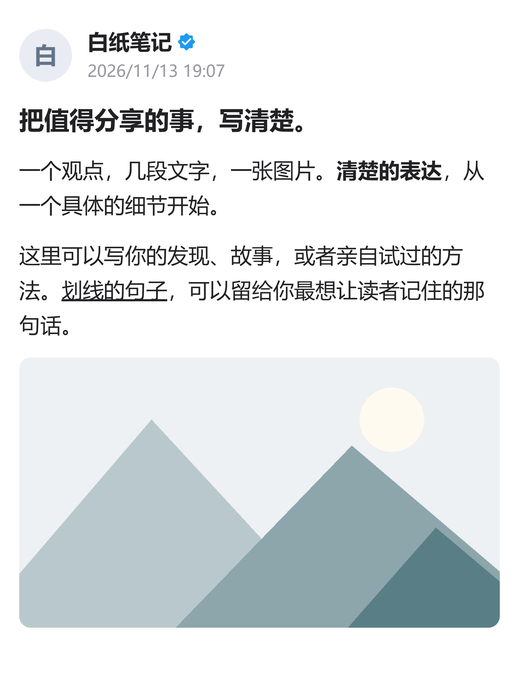

# 白纸图文卡片 · White Card Skill

把一篇文章和几张图片，排成白底黑字的社交图文卡片。既能交给 AI 自动制作，也能在一个网页编辑框里继续修改。



- 圆形头像、昵称、灰色日期，以及可关闭的蓝色勾标。
- 统一图文编辑框：插入图片、拖动调整大小、加粗、下划线，图片后继续写正文。
- 按完整段落自动分页，各页字号一致。超过整页的超长段落按行续排。
- 默认输出 **2160 × 2880 PNG**，支持 3:4、4:5、9:16 和 1:1。
- 自动导出 PNG 的同时保留独立 HTML 和 JSON 草稿。
- 本地处理，无账号、API Key、在线图片服务或付费服务依赖。首次自动导出需要安装运行依赖。

## 在 Codex 中安装

对 Codex 说：

```text
$skill-installer 从 GitHub 仓库 liuxiaocuiwork-png/white-card-skill
安装 skills/white-card
```

然后使用：

```text
使用 $white-card，把这篇文章和配图做成图文卡片。
昵称用“白纸笔记”，第二段后的图片占正文宽度 70%，重点加粗，导出高清 PNG。
```

Skill 文件位于 [`skills/white-card/SKILL.md`](skills/white-card/SKILL.md)。支持文件夹型 Agent Skills 的其他客户端，也可以安装这个目录；具体安装路径以客户端说明为准。

## 只使用网页编辑器

下载仓库 ZIP，解压后用浏览器打开 `skills/white-card/assets/editor.html`。

它是无外部依赖的单文件网页。输入文案、上传图片，点击“导出全部图片”；多页会自动打包为 ZIP。如果浏览器限制本地文件操作，可在该目录运行 `python -m http.server 4173 --bind 127.0.0.1`，再访问 `http://127.0.0.1:4173/editor.html`。

## 命令行自动制作

需要 Node.js 20 或更高版本。从仓库根目录运行：

```bash
cd skills/white-card
npm ci --ignore-scripts
npx playwright install chromium
node scripts/render.mjs --input ../../examples/article.md --out ../../output/example --nickname "白纸笔记"
```

Windows 已安装 Edge 时，可以省略下载 Chromium，并使用：

```bash
node scripts/render.mjs --input ../../examples/article.md --out ../../output/example-edge --nickname "白纸笔记" --channel msedge
```

输出包括：

```text
output/example/
├── card-01.png       # 按页编号的高清 PNG
├── card-02.png
├── editor.html       # 填好初始内容，可继续编辑
├── draft.json        # 可导入的完整草稿
├── manifest.json     # 页数、尺寸、文件列表
└── layout.json       # SVG 与排版位置，供检查
```

输出目录必须是新的或空目录。独立 HTML 重新打开时会载入初始内容；修改后请点击“保存草稿”保存 JSON，便于下次导入。

仅生成可编辑文件，无需安装 npm 依赖：

```bash
node scripts/create-draft.mjs --input ../../examples/article.md --out ../../output/draft
```

## 文案与图片

Markdown 支持一级标题、空行分段、`**加粗**`、`<u>下划线</u>`、独占一行的 `` 和用 `---` 手动分页。其余语法按普通文字处理。图片路径相对于文章文件，可用 PNG、JPEG、WebP。

需要精确控制图片宽度、局部格式和排版参数时，参考 [`examples/mixed.json`](examples/mixed.json) 与 [完整草稿格式](skills/white-card/references/draft-format.md)。

常用选项：

```text
--nickname 昵称    --title 标题       --date 日期
--avatar 头像路径  --ratio 3:4        --scale 2
--no-badge         --channel msedge  --font 字体.ttf
```

Linux 需要可用的中文字体，例如 Noto Sans CJK SC。不同机器的系统字体可能导致不同换行；用 `--font` 指定同一个 TTF/OTF 字体可保持一致。指定的字体会嵌入生成的独立 HTML，分享前请确认字体许可；仓库本身不分发系统字体。

最长支持 60 页；标题必须放得下一页。蓝色勾标仅是卡片装饰，不表示平台认证或实际关注关系。工具不会自动把卡片发布到社交平台。

## 开发与验证

```bash
node --test tests/draft.test.mjs
node tests/render.test.mjs
```

第二条需要已安装 Chromium；本机 Edge 可用 `node tests/render.test.mjs --channel msedge`。测试覆盖文案保留、字体一致、整段分页、超长段落续页、图片缩放、PNG 尺寸和错误输入。

浏览器编辑器和自动导出共用 `assets/editor.html` 内的排版引擎。`window.WhiteCard` 提供异步 `ready`、`load(draft)`、`inspect()`、`png(index)` 和 `draft()`；自动导出使用全新浏览器上下文和仅监听 127.0.0.1 的临时服务，不读取个人浏览器会话。

## 许可证

[MIT](LICENSE)。示例插画为本项目绘制，随项目使用同一许可证。
